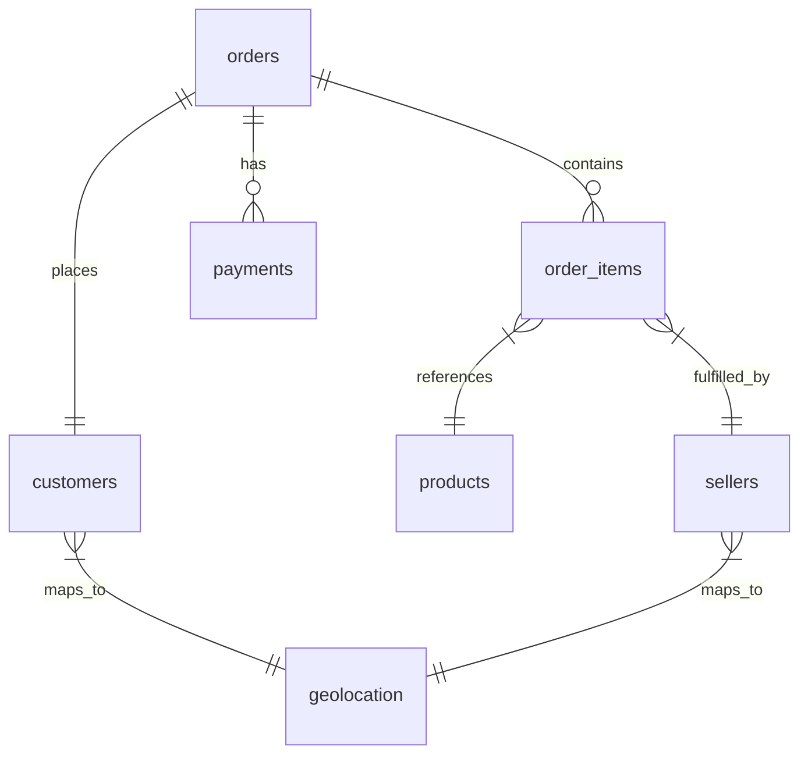

# Target Brazil E-Commerce Operations Analysis (2016–2018)


## 📌 Project Overview
This repository contains an end-to-end exploratory data analysis (EDA) and business intelligence case study of **Target's e-commerce operations in Brazil** from **2016 to 2018**. 

Using a multi-table relational database comprising over 100,000 orders, this project evaluates the full data lifecycle—ranging from database schema exploration and customer segmentation to financial inflow tracking, logistics efficiency bottlenecks, and regional fulfillment disparities.

---

## 🗄️ Dataset & Relational Schema
The underlying data is segmented into eight core operational tables:
1. **`customers.csv`** – Customer demographics and geographic locations.
2. **`orders.csv`** – Overarching order metadata, statuses, and purchase timestamps.
3. **`order_items.csv`** – Specific line items, pricing, and freight charges per order.
4. **`payments.csv`** – Transaction payment methods, values, and installment terms.
5. **`products.csv`** – Product attributes, categories, and dimensions.
6. **`sellers.csv`** – Merchant details and location footprints.
7. **`geolocation.csv`** – Zip-code coordinate mappings across Brazil.
8. **`reviews.csv`** – Customer review scores and feedback text.



---

## 🔍 Key Business Analysis & SQL Breakdown

The accompanying SQL script (`target_brazil_ecommerce_analysis.sql`) addresses key operational and economic vectors:

### 1. Market Penetration & Temporal Trends
* **Operating Span:** Analyzed a robust 773-day active transactional lifecycle.
* **Geographic Reach:** Confirmed complete market saturation across all **27 Brazilian states** and **4,119 distinct cities**.
* **Seasonality & Growth:** Identified a massive, isolated Black Friday consumer dependency (e.g., November sales surging to nearly double normal monthly baselines) and tracked the platform's transition from a 2017 hyper-growth phase (+13,608% YoY) to stable, mature scaling in 2018 (~20% YoY growth).

### 2. Economic & Financial Insights
* **Revenue Plateau:** Established that monthly gross revenue stabilized between **1.3 million to 1.5 million BRL** during mature operational windows.
* **The Freight Tax:** Quantified the structural logistics cost, revealing a locked-in **11% to 12% freight-to-revenue ratio** across transactions.
* **Installment Culture:** Discovered that over **51% of transactions are financed**, with a strong consumer preference for short-to-medium-term terms and a unique psychological volume spike at **10-month installments**.

### 3. Logistical Friction & Regional Disparities
* **The Southeast Powerhouse:** São Paulo (SP) acts as the core revenue engine (capturing over 5.20 million BRL in gross product value).
* **The Northern/Frontier Penalty:** Highlighted extreme logistics discrepancies. While SP enjoys elite single-digit delivery speeds (~8.7 days) and low freight costs (~15.15 BRL), northern frontier states like Roraima (RR) experience multi-week delays (~29.3 days) and high freight fees (~42.98 BRL).

---

## 🚀 Repository Contents
* **`target_brazil_ecommerce_analysis.sql`**: Production-ready, cleanly formatted SQL queries optimized for platforms like MySQL, PostgreSQL, or Google BigQuery.

---

## 💡 Strategic Recommendations for Stakeholders
1. **Optimize Checkout SLAs:** Reduce overly conservative delivery buffer estimates at checkout to improve front-end conversion rates, while keeping actual post-purchase timelines intact.
2. **Regional Fulfillment Hubs:** Consider establishing micro-fulfillment nodes or cross-docking stations in the North/Northeast to mitigate long-tail shipping costs and transit times.
3. **Targeted Tiered Shipping:** Introduce tiered free-shipping thresholds to encourage larger basket sizes that naturally offset high freight overhead in remote states.
```

---

### What to do next:
1. Copy the Markdown code above and save it in your GitHub repository as `README.md`.
2. Ensure your `target_brazil_ecommerce_analysis.sql` file is uploaded in the same repository. Your portfolio project is now fully documented and ready to showcase to hiring managers!